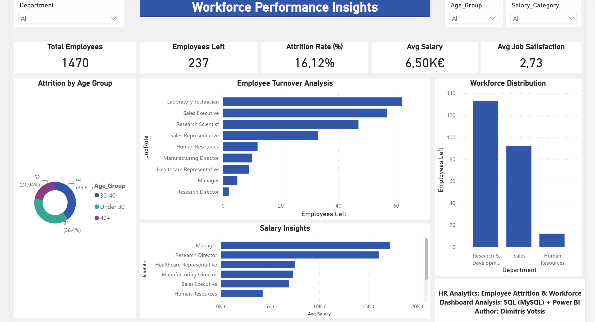
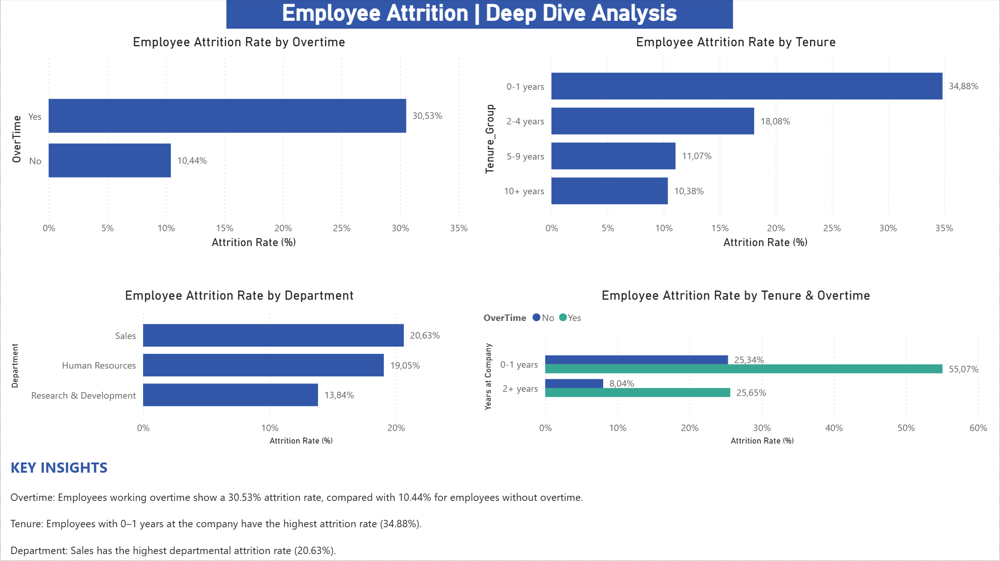
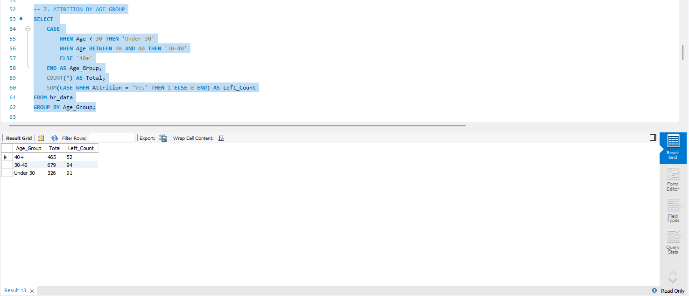
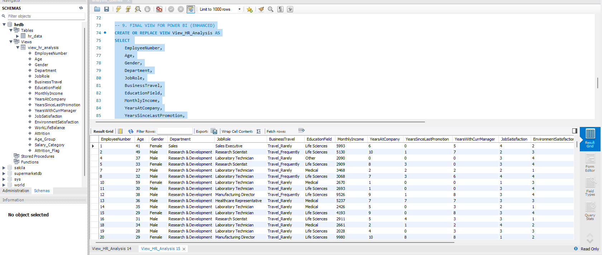

# HR Analytics | Employee Attrition Analysis

## Project Overview

This project analyzes employee attrition across a dataset of 1,470 employees using SQL and Power BI.

The goal was to understand how employee turnover varies across departments, job roles, overtime status, and years at the company. I used MySQL for exploratory analysis and Power BI to build an interactive dashboard that presents the main workforce metrics and explores attrition patterns in more detail.

The project focuses on identifying areas that HR teams could investigate to improve employee retention.

## Tools Used

- **MySQL:** Data exploration, aggregation, CASE statements, and SQL views
- **Power BI:** Dashboard development, DAX measures, and data visualization
- **Power Query:** Data preparation, data types, and employee grouping
- **CSV:** Source data for the Power BI report

## Key Metrics

| Metric | Value |
|---|---|
| Total Employees | 1,470 |
| Employees Who Left | 237 |
| Attrition Rate | 16.12% |
| Average Monthly Income | 6.50K |
| Average Job Satisfaction | 2.73 |

## Power BI Dashboard

I created a two-page Power BI report to explore workforce characteristics and employee attrition.

### Workforce Overview

The first page provides an overview of the workforce, including employee headcount, attrition rate, average income, and job satisfaction.

It also shows employee departures by age group, job role, and department, along with average income by job role.



### Employee Attrition Deep Dive

The second page focuses on attrition rates across different employee groups.

I compared employees who work overtime with those who do not, analyzed attrition by years at the company, and examined differences between departments.

I also combined overtime and tenure to see how attrition varies when both factors are considered.



## Key Findings

### Overtime and Attrition

Employees working overtime had an attrition rate of **30.53%**, compared with **10.44%** for employees who did not work overtime.

This was one of the clearest differences in the dataset. It suggests that overtime and workload are worth investigating further when reviewing employee retention.

### Attrition by Years at the Company

| Years at Company | Attrition Rate |
|---|---|
| 0–1 years | 34.88% |
| 2–4 years | 18.08% |
| 5–9 years | 11.07% |
| 10+ years | 10.38% |

Employees with 0–1 years at the company had the highest attrition rate.

Attrition was lower among employees with longer tenure. This makes onboarding and support for new employees useful areas for further investigation.

### Attrition by Department

| Department | Attrition Rate |
|---|---|
| Sales | 20.63% |
| Human Resources | 19.05% |
| Research & Development | 13.84% |

Sales had the highest attrition rate, followed by Human Resources.

These differences could help HR teams decide where to investigate employee experiences and working conditions more closely.

### Combining Overtime and Tenure

| Years at Company | No Overtime | Overtime |
|---|---|---|
| 0–1 years | 25.34% | 55.07% |
| 2+ years | 8.04% | 26.65% |

The highest attrition rate, **55.07%**, was found among employees with 0–1 years at the company who also worked overtime.

This was an important finding because it showed how looking at two factors together can reveal differences that are less visible in separate charts.

These results show associations within the dataset and do not establish that overtime or tenure directly causes employees to leave.

## SQL Analysis

I used MySQL to explore the HR dataset and calculate workforce metrics.

The SQL analysis includes employee counts, attrition calculations, demographic grouping, and a view named `View_HR_Analysis`.

The view uses CASE statements to group employees by age and convert the Attrition field into a numeric indicator.

```sql
CASE
    WHEN Age < 30 THEN 'Under 30'
    WHEN Age BETWEEN 30 AND 40 THEN '30-40'
    ELSE '40+'
END AS Age_Group,

CASE
    WHEN Attrition = 'Yes' THEN 1
    ELSE 0
END AS Attrition_Flag
```

The Power BI report uses the CSV dataset directly, with additional transformations performed in Power Query. The SQL analysis is a separate part of the project.

### SQL Screenshots





## Project Structure

```text
HR-Analytics-Attrition-Analysis/
|
|-- 01_Data/
|   |-- HR_Final_Data.csv
|   |-- hr_data.csv
|
|-- 02_SQL/
|   |-- analysis_queries.sql
|
|-- 03_PowerBI/
|   |-- HR Analytics Dashboard.pdf
|   |-- HR Analytics.pbix
|
|-- 04_Screenshots/
|   |-- workforce_overview.png
|   |-- attrition_deep_dive.png
|   |-- hr_analytics_dashboard_final.png
|   |-- sql_age_group_analysis.png
|   |-- sql_view_architecture.png
|
|-- README.md
```

## Project Files

- [Power BI Dashboard (PDF)](./03_PowerBI/HR%20Analytics%20Dashboard.pdf)
- [Power BI Report (.pbix)](./03_PowerBI/HR%20Analytics.pbix)
- [SQL Queries](./02_SQL/analysis_queries.sql)
- [HR Dataset](./01_Data/HR_Final_Data.csv)

## Conclusion

The analysis showed that attrition was particularly high among employees working overtime and employees in their first years at the company.

The combined analysis of overtime and tenure provided a more detailed view of these patterns and highlighted a group with a particularly high attrition rate.

Through this project, I practiced SQL analysis, data preparation, DAX calculations, and Power BI dashboard development, with a focus on presenting findings that are useful for business decisions.
