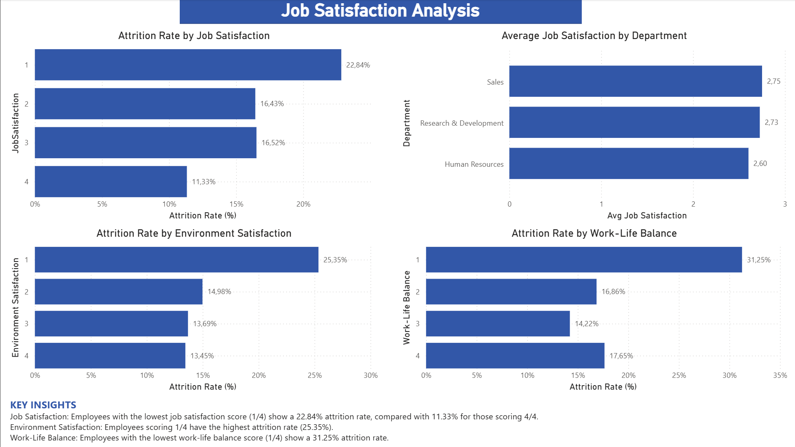

# HR Analytics | Employee Attrition Analysis

## Project Overview

This project analyzes employee attrition using a dataset of 1,470 employees.

I used MySQL to explore the data and calculate attrition metrics, and Power BI to build a three-page report. The analysis focuses on employee turnover across departments, overtime status, years at the company, job satisfaction, environment satisfaction, and work-life balance.

The main goal was to identify patterns in employee attrition and understand which groups might need further attention from HR teams.

## Tools Used

- **MySQL:** Data exploration, validation, aggregation, CASE statements, and SQL views
- **Power BI:** Dashboard development, DAX measures, and data visualization
- **Power Query:** Data preparation and employee grouping
- **CSV:** Source dataset

## Key Metrics

| Metric | Value |
|---|---|
| Total Employees | 1,470 |
| Employees Who Left | 237 |
| Attrition Rate | 16.12% |
| Average Monthly Income | 6.50K |
| Average Job Satisfaction | 2.73 |

## Power BI Report

I created three report pages to explore different aspects of the HR dataset.

### Workforce Overview

The first page presents the main workforce metrics, including total employees, employee departures, attrition rate, average income, and job satisfaction.

It also shows employee distribution across departments, departures by age group and job role, and average income by job role.


### Attrition Deep Dive

The second page focuses on attrition rates across different employee groups.

I compared attrition by overtime status, years at the company, and department. I also combined overtime and tenure to see whether certain groups had noticeably different attrition rates.


### Job Satisfaction Analysis

The third page examines employee satisfaction and its relationship with attrition.

It includes attrition rates by job satisfaction, environment satisfaction, and work-life balance, along with average job satisfaction by department.



## Key Findings

### Overtime and Attrition

| Overtime | Employees | Employees Who Left | Attrition Rate |
|---|---:|---:|---:|
| Yes | 416 | 127 | 30.53% |
| No | 1,054 | 110 | 10.44% |

Employees working overtime had an attrition rate of 30.53%, compared with 10.44% for employees who did not work overtime.

This was one of the largest differences I found in the dataset and made overtime an important area to investigate further.

### Attrition by Years at the Company

| Years at Company | Employees | Employees Who Left | Attrition Rate |
|---|---:|---:|---:|
| 0–1 years | 215 | 75 | 34.88% |
| 2–4 years | 365 | 66 | 18.08% |
| 5–9 years | 524 | 58 | 11.07% |
| 10+ years | 366 | 38 | 10.38% |

Employees with 0–1 years at the company had the highest attrition rate at 34.88%.

Attrition was lower among employees with longer tenure. This suggests that onboarding and support during the first years of employment are worth examining.

### Attrition by Department

| Department | Employees | Employees Who Left | Attrition Rate |
|---|---:|---:|---:|
| Sales | 446 | 92 | 20.63% |
| Human Resources | 63 | 12 | 19.05% |
| Research & Development | 961 | 133 | 13.84% |

Sales had the highest attrition rate at 20.63%, followed by Human Resources at 19.05%.

Research & Development had the largest number of employees who left, but the lowest attrition rate among the three departments.

### Combining Overtime and Tenure

| Years at Company | Overtime | Employees | Employees Who Left | Attrition Rate |
|---|---|---:|---:|---:|
| 0–1 years | Yes | 69 | 38 | 55.07% |
| 0–1 years | No | 146 | 37 | 25.34% |
| 2+ years | Yes | 347 | 89 | 25.65% |
| 2+ years | No | 908 | 73 | 8.04% |

The highest attrition rate, 55.07%, was found among employees with 0–1 years at the company who also worked overtime.

Looking at tenure and overtime together helped me identify a group with a much higher attrition rate than the overall workforce.

### Job Satisfaction and Attrition

| Job Satisfaction | Attrition Rate |
|---|---:|
| 1 | 22.84% |
| 2 | 16.43% |
| 3 | 16.52% |
| 4 | 11.33% |

Employees with the lowest job satisfaction score (1) had an attrition rate of 22.84%, compared with 11.33% among employees with the highest score (4).

The difference suggests that job satisfaction is worth considering when analyzing employee turnover.

### Environment Satisfaction and Attrition

| Environment Satisfaction | Attrition Rate |
|---|---:|
| 1 | 25.35% |
| 2 | 14.98% |
| 3 | 13.69% |
| 4 | 13.45% |

Employees with the lowest environment satisfaction score had the highest attrition rate at 25.35%.

The other three groups had lower and relatively similar attrition rates.

### Work-Life Balance and Attrition

| Work-Life Balance | Attrition Rate |
|---|---:|
| 1 | 31.25% |
| 2 | 16.86% |
| 3 | 14.22% |
| 4 | 17.65% |

Employees with the lowest work-life balance score had an attrition rate of 31.25%.

The relationship was not completely linear, since employees with a score of 4 had a slightly higher attrition rate than those with a score of 3.

## SQL Analysis

I used MySQL to explore the dataset and validate the main attrition calculations.

The SQL script includes:

- Data quality checks and employee counts
- Overall attrition rate
- Attrition by department and age group
- Attrition by job satisfaction
- Attrition by employee tenure
- Attrition by overtime status
- Combined analysis of tenure and overtime
- A reusable SQL view named `View_HR_Analysis`

The SQL view groups employees into age categories and converts the Attrition field into a numeric indicator using CASE statements.

The Power BI report imports the CSV dataset directly and uses Power Query for additional transformations. The SQL analysis is a separate part of the project and does not serve as the data source for Power BI.

## Project Structure

```text
HR-Analytics-Attrition-Analysis/
|
|-- 01_Data/
|   |-- HR_Final_Data.csv
|
|-- 02_SQL/
|   |-- analysis_queries.sql
|
|-- 03_PowerBI/
|   |-- HR Analytics Dashboard.pdf
|   |-- HR Analytics.pbix
|
|-- 04_Screenshots/
|   |-- workforce_overview.png
|   |-- attrition_deep_dive.png
|   |-- job_satisfaction_analysis.png
|
|-- README.md
```

## Project Files

- [Power BI Dashboard (PDF)](./03_PowerBI/HR%20Analytics%20Dashboard.pdf)
- [Power BI Report (.pbix)](./03_PowerBI/HR%20Analytics.pbix)
- [SQL Queries](./02_SQL/analysis_queries.sql)
- [HR Dataset](./01_Data/HR_Final_Data.csv)

## Conclusion

The analysis showed higher attrition rates among employees working overtime, employees with shorter tenure, and employees reporting low satisfaction scores.

The combined analysis of overtime and tenure was particularly useful because it revealed differences that were less visible when examining these factors separately.

This project helped me practice SQL analysis, data validation, DAX calculations, Power Query transformations, and Power BI reporting.

The findings describe patterns within the dataset rather than proven causes of employee turnover.
